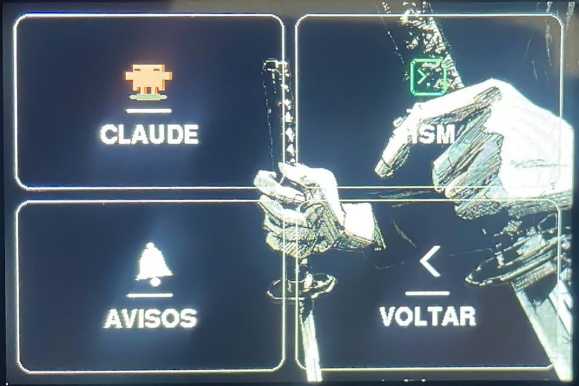
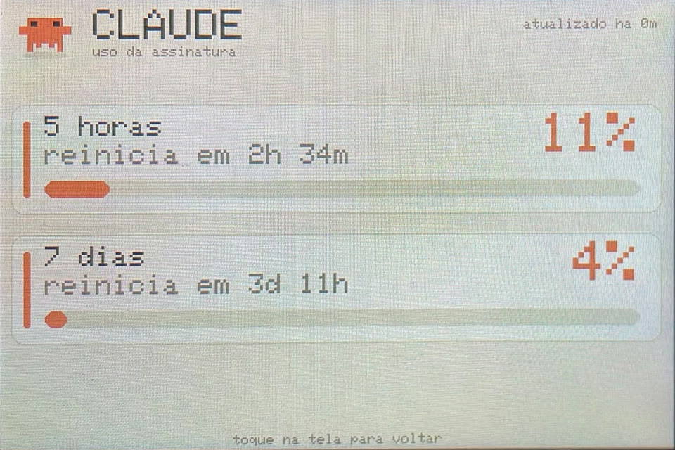

# ESP32-S3 Stream Deck

Stream deck caseiro num **ESP32-S3 com tela touch de 3.5"** (placa
Guition/Sunton **JC3248W535**). Tocou num botão, o PC reage — via **USB HID
nativo**, sem nenhum software rodando no PC para o uso do dia a dia.

<table>
  <tr>
    <td width="50%" align="center">
      <br>
      <b>Grade de botões</b><br>
      <sub>Imagem de fundo e ícones animados (o mascote dança, o sino toca).</sub>
    </td>
    <td width="50%" align="center">
      <br>
      <b>Uso do Claude</b><br>
      <sub>Janelas de 5 horas e 7 dias: porcentagem, barra e tempo até reiniciar.</sub>
    </td>
  </tr>
</table>

## O que faz

- **Botões configuráveis** (até 8) com cor, texto ou ícone 64×64, e estes tipos de ação:
  - **Tecla** — envia `F13`–`F24`. Essas teclas não existem em teclados comuns,
    então não conflitam com atalhos do sistema: associe-as dentro do app que você
    quer controlar (OBS, Discord…).
  - **Macro** — digita um texto, opcionalmente abrindo antes o Win+R e/ou
    finalizando com Enter (ex.: abrir um site ou rodar um comando).
  - **Volume** — aumentar, diminuir e mudo, como tecla de mídia do sistema.
- **Tela de descanso** com GIF animado em loop depois de alguns segundos sem toque.
- **Imagem de fundo** atrás da grade de botões.
- **Telas extras alimentadas pelo PC** (a placa não tem Wi-Fi; os dados chegam por USB):
  - **Status de servidores/PCs** — um card por máquina, paginado de 3 em 3.
  - **Uso do Claude** — limites da assinatura (5 h e 7 dias).
  - **Notificações do Windows** — lista rolável das últimas 20.
- **App de configuração no navegador** (Web Serial, sem instalar nada e sem recompilar).

Tudo que você configura (botões, ícones, GIF, fundos) fica gravado na **flash da
própria placa** (LittleFS): sobrevive a reboots e funciona em qualquer PC.

## Sumário

- [Começando](#começando)
- [Hardware](#hardware)
- [Build e gravação](#build-e-gravação)
- [App de configuração](#app-de-configuração)
- [Botões](#botões)
- [Telas de descanso e fundo](#telas-de-descanso-e-fundo)
- [Telas alimentadas pelo PC (ponte USB)](#telas-alimentadas-pelo-pc-ponte-usb)
- [Ícones dos botões](#ícones-dos-botões)
- [Protocolo serial](#protocolo-serial)
- [Estrutura do repositório](#estrutura-do-repositório)
- [Problemas comuns](#problemas-comuns)
- [Licença](#licença)
- [Créditos](#créditos)

## Começando

1. Instale o [PlatformIO](https://platformio.org/) e grave o firmware
   ([detalhes](#build-e-gravação)):
   ```
   pio run -t upload
   ```
2. Abra [`configurator/index.html`](configurator/index.html) no **Chrome ou Edge**,
   clique em **Conectar**, escolha a placa e monte seus botões.
3. *(Opcional)* Para as telas de status, uso do Claude e notificações, deixe a
   [ponte](#telas-alimentadas-pelo-pc-ponte-usb) rodando no PC:
   ```
   powershell -ExecutionPolicy Bypass -File tools\bridge.ps1
   ```

## Hardware

- ESP32-S3 com 16 MB de flash e 8 MB de PSRAM octal (módulo N16R8)
- Display IPS 3.5" 320×480 (usado em paisagem, 480×320), touch capacitivo,
  controlador **AXS15231B** (QSPI)
- Placa: Guition/Sunton **JC3248W535**

| Função          | Pino               |
|-----------------|--------------------|
| LCD CS          | GPIO45             |
| LCD CLK         | GPIO47             |
| LCD D0–D3       | GPIO21, 48, 40, 39 |
| LCD Backlight   | GPIO1              |
| Touch SDA       | GPIO4              |
| Touch SCL       | GPIO8              |
| Touch INT       | GPIO3              |
| Touch I2C addr  | 0x3B               |

## Build e gravação

Projeto PlatformIO (Arduino framework). A porta de upload está fixa em `COM8`
no [`platformio.ini`](platformio.ini) — ajuste `upload_port` e `monitor_port`
para a sua.

```
pio run -t upload
```

### Entrando em modo de gravação

O firmware usa o USB OTG nativo (necessário para expor o teclado HID), então
ele **não responde ao auto-reset do esptool** depois da primeira gravação. Para
regravar:

1. Segure o botão **BOOT**
2. Com ele pressionado, desconecte e reconecte o cabo USB
3. Espere ~2 s e solte o **BOOT**
4. Confirme a porta COM (em modo de gravação o dispositivo aparece com outro
   VID/PID) e rode `pio run -t upload`

### Notas do `platformio.ini`

- `board_build.arduino.memory_type = qio_opi` — **obrigatório** para a PSRAM
  octal funcionar; sem isso o display não inicializa.
- **Não use** a partição `default_16MB.csv` nesta placa: ela trava o boot em
  loop. A tabela padrão do board (`default_8MB.csv`, implícita) cabe de sobra no
  firmware (~400 KB) mesmo com `flash_size = 16MB`.
- `board_build.extra_flags` força `ARDUINO_USB_MODE=0` (USB OTG nativo +
  TinyUSB), porque o `board.json` do `esp32-s3-devkitc-1` fixa `1`
  (USB-Serial/JTAG, que não suporta HID).
- Configuração, ícones, fundos e GIF vivem na partição `spiffs` já existente no
  `default_8MB.csv` (1,5 MB, offset `0x670000`), montada com **LittleFS**. Não
  foi preciso criar partição nova.

## App de configuração

Página estática em [`configurator/`](configurator/) (HTML/CSS/JS puro, sem build
e sem dependências) que conversa direto com a placa pela **Web Serial API**.
Edita rótulo, ação, cor e ícone de cada botão, o tempo até a tela de descanso, o
GIF e as imagens de fundo.

**Navegadores:** Chrome e Edge (desktop) têm suporte oficial; funcionou também no
Firefox Developer Edition (experimental). Não funciona em mobile nem no Safari.

**Como abrir:** dê duplo clique em [`configurator/index.html`](configurator/index.html).
Se o navegador bloquear por rodar como `file://`, sirva a pasta:

```
npx serve configurator
```

**Fluxo:** **Conectar** (seletor nativo de porta serial) → **Carregar do
dispositivo** (opcional) → edite os botões → **Salvar no dispositivo**. Ícones são
enviados na hora em que você escolhe a imagem; o GIF e os fundos têm botão
**Enviar** próprio.

> A porta serial só aceita **um programa por vez**: feche a ponte antes de usar o
> configurador e abra de novo depois.

## Botões

Os botões ficam em `/config.json` na flash. Edite pelo
[app de configuração](#app-de-configuração) (recomendado) ou mude os valores de
fábrica em `Config::loadDefaults()` ([`src/Config.cpp`](src/Config.cpp)) e
regrave o firmware — esses padrões só valem na primeira inicialização ou se o
arquivo estiver ausente/corrompido.

Tipos de botão ([`src/Config.h`](src/Config.h)):

| `type` | Campos usados | O que faz |
|---|---|---|
| `key` | `key` (`F13`..`F24`) | Pressiona a tecla de função |
| `macro` | `macro_text`, `macro_winr`, `macro_enter` | Digita `macro_text`; com `macro_winr`, abre o Win+R antes (espera ~300 ms); com `macro_enter`, pressiona Enter no final |
| `volume_up` / `volume_down` / `volume_mute` | — | Tecla de mídia do sistema |
| `status` | — | Abre a [tela de status](#status-de-servidores) |
| `usage` | — | Abre a [tela de uso do Claude](#uso-do-claude) |
| `notifications` | — | Abre a [lista de notificações](#notificações-do-windows) |
| `screensaver` | — | Volta na hora para a tela de descanso |

Cores usam hex `#RRGGBB`. Ícones são opcionais, um por botão.

**Exemplo de macro** para abrir um site no navegador padrão: `macro_text` =
`https://discord.com/app`, `macro_winr` = `true`, `macro_enter` = `true`. Para um
navegador específico: `chrome.exe https://discord.com/app` (precisa estar no PATH).

## Telas de descanso e fundo

### Tela de descanso (GIF)

Depois de `idle_timeout_ms` (padrão 30 s) sem toque, a placa toca em loop o GIF
gravado em `/screensaver.gif`. Qualquer toque volta para a grade.

- Sem GIF gravado, a tela de descanso não é ativada.
- Limite de **~1000 KB** (`MAX_GIF_SIZE` em [`src/Screensaver.h`](src/Screensaver.h)).
  Prefira GIFs pequenos: 480×320 ou menos, poucas cores e poucos segundos de loop
  — pelo espaço e pela velocidade de decodificação.
- A placa **não redimensiona** o GIF: ela desenha no tamanho original e corta o que
  passar de 480×320. O script [`tools/prepare-gif.ps1`](tools/prepare-gif.ps1)
  (requer `ffmpeg`) converte um GIF/vídeo para 480×320 já dentro do limite de tamanho.
- Envio pelo configurador (botão **Enviar** na seção GIF) ou, sem navegador, por
  [`tools/send-gif.ps1`](tools/send-gif.ps1) (`-Gif arquivo.gif`; `-Remove` apaga).

### Imagem de fundo da grade

No configurador, seção *Imagem de fundo da grade*, escolha uma imagem (JPG/PNG) e
clique em **Enviar fundo**. Ela é recortada para 480×320, convertida para RGB565
(300 KB, `/background.rgb565`) e redesenhada na hora. Com fundo, as caixas dos
botões viram um vidro escuro translúcido; a opacidade (10–100 %, padrão 70 %) é o
controle *Opacidade das caixas* e vale depois de **Salvar no dispositivo**.

> A partição de arquivos tem só 1,5 MB, dividida entre GIF (até ~1000 KB), ícones
> e fundos. Se não couber, o envio falha com `no_space`: use um GIF menor ou
> remova o GIF.

## Telas alimentadas pelo PC (ponte USB)

A placa não tem Wi-Fi. Status, uso do Claude e notificações chegam pelo PC, via
USB, através de uma **ponte** em PowerShell que fica rodando no Windows:

```
powershell -ExecutionPolicy Bypass -File tools\bridge.ps1
```

| Script | Faz |
|---|---|
| [`tools/bridge.ps1`](tools/bridge.ps1) | **Tudo junto** numa conexão só (recomendado) |
| [`tools/status-bridge.ps1`](tools/status-bridge.ps1) | Só status dos servidores |
| [`tools/notify-bridge.ps1`](tools/notify-bridge.ps1) | Só notificações do Windows |

Pontos em comum:

- Como a porta serial só aceita um programa, **não rode** `status-bridge.ps1` e
  `notify-bridge.ps1` ao mesmo tempo — use o `bridge.ps1`.
- A placa é detectada sozinha (VID `303A`); use `-Port COM3` para forçar.
- Para subir junto com o Windows: crie um atalho para o comando acima (com
  `-WindowStyle Hidden` no `powershell.exe`) em `shell:startup`.
- A ponte aceita `-NoNotify` (desliga notificações) e `-NoUsage` (desliga o uso do Claude).

### Status de servidores

Um botão do tipo `status` abre uma tela com **um card por PC/servidor** (nome,
ONLINE/OFFLINE, host, IP, barras de CPU/RAM/disco, tempo ligado e histórico
recente), em páginas de 3 cards, até 24 máquinas. Tocar na tela volta para a
grade (ou volta sozinho após 2 min). A placa pede os dados ao abrir a tela e a
cada 5 s.

A ponte lê um endpoint HTTP que **você** aponta — nada vem configurado de fábrica:

```
$env:HSM_URL = 'https://seu-painel.exemplo/api/pcs'
# se o painel exigir HTTP Basic Auth:
$env:HSM_USER = 'usuario'
$env:HSM_PASSWORD = 'senha'
powershell -ExecutionPolicy Bypass -File tools\bridge.ps1
```

Também dá para passar `-Url`, `-User` e `-Password` direto na linha de comando.
Sem URL, a tela mostra "servidor inacessível". `-DryRun` (no `status-bridge.ps1`)
imprime o que seria enviado, sem abrir a serial.

**Formato esperado da API** (`GET`, JSON). Só `pcs` é essencial; os demais campos
são opcionais:

```json
{
  "servidor": true,
  "pcs": [
    {
      "nome": "PC da sala", "host": "desktop-01", "ip": "192.168.0.10",
      "online": true, "cpu": 23, "ram": 61, "disco": 48,
      "uptime": 93600, "semSinalSeg": 0,
      "so": "Windows 11", "eventos24h": 2, "streak": 12, "streakTotal": 20,
      "historico": [true, true, false, true],
      "desde": 1730000000000
    }
  ]
}
```

`cpu`, `ram` e `disco` em %, `uptime` e `semSinalSeg` em segundos, `desde` em
milissegundos desde a época Unix.

### Uso do Claude

Um botão `usage` abre as janelas de limite da assinatura (5 horas e 7 dias):
porcentagem, barra e tempo até reiniciar. A tela fica fixa até tocar (não cai na
tela de descanso).

O [`tools/bridge.ps1`](tools/bridge.ps1) inicia em segundo plano o
[`tools/claude_usage.py`](tools/claude_usage.py), que consulta a API de uso a cada
5 min (dobrando até 30 min se levar 429) e repassa o último valor à placa. Requer
**Python 3** e o **Claude Code logado** no PC.

- **Privacidade:** o token do Claude Code só é lido por
  [`tools/claude_oauth.py`](tools/claude_oauth.py), em modo somente leitura, e só
  é enviado para `api.anthropic.com` por HTTPS. Ele nunca é impresso, logado ou
  gravado; a ponte e a placa recebem apenas porcentagens e textos.
- Se o dado tiver mais de 15 min, ou o token estiver ausente/vencido/recusado, a
  tela mostra um aviso em âmbar. Sem resposta do PC por 90 s, o cabeçalho diz
  `SEM ATUALIZAR`.
- Há também uma janelinha no PC: `tools\claude-usage-window.ps1`.
- **Fundo próprio** (opcional), com cards translúcidos por cima:
  ```
  powershell -ExecutionPolicy Bypass -File tools\send-usage-bg.ps1 -Image foto.avif
  ```
  Recorta para 480×320 e grava **comprimido (RLE)**, porque o bitmap cru (300 KB)
  não cabe junto com o GIF e o fundo da grade. Imagens quase chapadas ocupam
  poucos KB; fotos cheias de detalhe podem não caber (`no_space`). Aceita
  AVIF/WebP (usa Chrome/Edge). `-Remove` apaga o fundo.

### Notificações do Windows

A placa mostra as últimas 20 notificações do PC (Discord, Telegram, e-mail, qualquer
app) numa lista escura e rolável, da mais recente para a mais antiga. A lista só
existe em RAM: some ao reiniciar a placa.

- **Quando aparece:** uma notificação nova interrompe qualquer tela e fecha sozinha
  após 10 s sem toque (aberta pelo botão `notifications`, fica 60 s). A seta `<`
  volta na hora.
- **Cada item:** ícone branco do app, título, descrição (2 linhas), horário relativo
  e uma bolinha azul se não foi lida. O número ao lado do título é a contagem de
  não lidas.
- **Toque:** marca como lida e abre a mensagem completa (até ~500 caracteres,
  rolável). **Marcar todas como lidas** fica no cabeçalho; arrastar rola, com inércia.
- A fonte da placa é só ASCII: os textos saem sem acento.
- Na primeira execução o Windows pede permissão ("Deixar o PowerShell acessar suas
  notificações?") — é preciso aceitar. Dá para revisar em **Configurações > Sistema >
  Notificações > Acesso a notificações**.
- `-IntervalSec` (em `notify-bridge.ps1`) / `-NotifyIntervalSec` (em `bridge.ps1`)
  mudam o intervalo do polling (padrão 2 s).

> **Limitação conhecida:** isso usa a API `UserNotificationListener`, que a Microsoft
> só documenta para apps empacotados (MSIX). Funciona por polling num script comum
> no Windows 11, mas não é garantido nem foi testado em todas as versões. Se não
> capturar nada, o caminho seria empacotar como *sparse package* com identidade —
> bem mais complexo.

## Ícones dos botões

Cada botão pode ter um ícone sobreposto à cor de fundo com alpha-blend; se houver
ícone, ele substitui o texto. Formato interno: **RGBA8888, 64×64** (16 384 bytes),
gravado em `/icon<índice>.rgba` (índice 0–7 = posição do botão).

O configurador converte qualquer imagem (PNG/JPG…) automaticamente: recorte
centralizado em 64×64 e envio dos bytes crus. Para transparência de verdade, use um
PNG com canal alpha. Os ícones usados nas fotos estão em [`assets/icons/`](assets/icons/).

## Protocolo serial

Linhas JSON terminadas em `\n`, via USB CDC a 115200 baud
(implementação em [`src/SerialProtocol.cpp`](src/SerialProtocol.cpp)).

**Comandos do PC para a placa**

| Comando | Resposta |
|---|---|
| `{"cmd":"ping"}` | `{"ok":true,"fw":"1.0.0","max_buttons":8,"max_gif_size":...,"icon_size":16384}` |
| `{"cmd":"get_config"}` | `{"ok":true,"config":{"buttons":[...],"idle_timeout_ms":...}}` |
| `{"cmd":"set_config","buttons":[...],"idle_timeout_ms":30000}` | `{"ok":true}` |
| `{"cmd":"delete_gif"}` | `{"ok":true}` |
| `{"cmd":"put_icon","index":0,"size":16384}` | `{"ok":true}` (upload em fases, abaixo) |
| `{"cmd":"delete_icon","index":0}` | `{"ok":true}` |
| `{"cmd":"reboot"}` | `{"ok":true}` e reinicia |

Exemplo de botão em `set_config`:
`{"label":"OBS","type":"key","key":"F13","macro_text":"","macro_winr":false,"macro_enter":false,"color":"#FF0000"}`.
Em `get_config`, cada botão também traz `has_icon`.

**Upload de GIF/ícone** (`put_gif` / `put_icon`) é feito em três fases, com
confirmação bloco a bloco (o conteúdo é binário e não cabe numa linha JSON):

1. o host envia o comando com o `size` total → a placa responde `{"ok":true}`;
2. o host manda os bytes em blocos pequenos e espera `{"ok":true,"received":N}`
   antes de mandar o próximo (controle de fluxo para não estourar o buffer do USB CDC);
3. ao terminar, a placa responde `{"ok":true,"written":N}`.

**Telas alimentadas pelo PC**

| Placa → PC | PC → Placa |
|---|---|
| `{"event":"status_request"}` | `{"cmd":"status","broker":true,"pcs":[{"n","h","ip","on","c","r","d","u","s",...}]}` ou `{"cmd":"status","error":"..."}` |
| `{"event":"usage_request"}` | `{"cmd":"usage","w":[{"l","p","r"}],"a":<idade em s>,"warn":"..."}` ou `{"cmd":"usage","error":"..."}` (`p` = %, `r` = s até reiniciar) |
| — | `{"cmd":"notify","app":"Discord","title":"...","body":"...","icon":"<base64>"}` (`icon` opcional: máscara 32×32, 1 byte por pixel) |

## Estrutura do repositório

```
src/            firmware (Arduino/PlatformIO): telas, protocolo serial, HID, config
lib/            driver do display/touch AXS15231B (vendorizado, MIT)
configurator/   app web de configuração (Web Serial)
tools/          pontes e utilitários em PowerShell/Python para rodar no PC
assets/         ícones, fundos e GIF de exemplo
docs/           fotos usadas neste README
platformio.ini  configuração de build e flash
```

## Problemas comuns

- **Não consigo regravar a placa** — entre em [modo de gravação](#entrando-em-modo-de-gravação) (BOOT + reconectar o USB).
- **Boot em loop** — confira se não está usando `default_16MB.csv` e se `memory_type = qio_opi` está ativo.
- **Display não liga** — falta `qio_opi` no `platformio.ini`.
- **Erro ao abrir a porta serial (configurador ou ponte)** — outro programa está
  usando a serial: a ponte, o monitor do PlatformIO ou outra aba do navegador.
- **Envio falha com `no_space`** — a partição de 1,5 MB está cheia; remova o GIF ou use uma imagem mais simples.
- **Notificações nunca chegam** — veja se o Windows concedeu o acesso ao PowerShell e a [limitação conhecida](#notificações-do-windows).
- **Tela de status diz "servidor inacessível"** — `HSM_URL` não definida, API fora do ar ou credenciais erradas.

## Licença

Distribuído sob a licença [MIT](LICENSE). Marcas e logos que aparecem nos ícones
(Claude, Discord, Telegram etc.) pertencem aos respectivos donos.

## Créditos

Driver de display/touch do AXS15231B vendorizado (MIT) de
[me-processware/JC3248W535-Driver](https://github.com/me-processware/JC3248W535-Driver).
